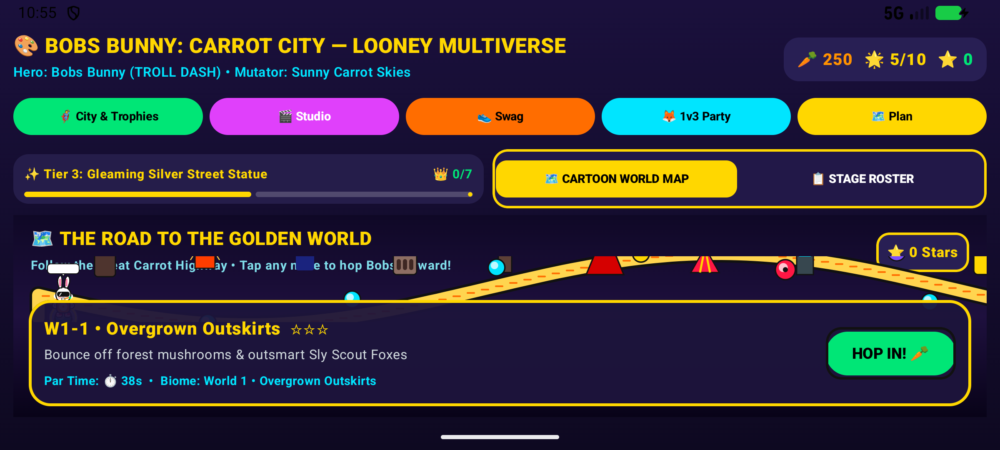

# Bob's Bunny — Wave 4 3D Diorama integration qualification

**Branch:** `feat/bobs-bunny-3d-diorama`  
**PR:** [#2](https://github.com/Bboy9090/Bobs-Bunny-Carrot-City/pull/2) (Draft; targets `feat/bobs-bunny-integration`)  
**Code commits:** `3440512`, `b10a851`  
**Status:** Functional vertical-slice qualification, NOT art or store-release approval.

## Changes in this wave

- **Renderer safety:** shader compile/link checks with descriptive failures, first-drawn-frame signal, loading overlay, OpenGL ES 3.0 capability check and automatic 2D fallback on renderer initialization failure.
- **UI:** landscape-focused phone activity, more compact two-line speech bubble to the right of the character, narrow button text fitted without overflow, touch-control accessibility actions.
- **Navigation regression:** scrollable world-filter selector has stable semantics; instrumented test drives W1-1 3D → 2D → 3D without replacing its game engine or stage state.

## Captured evidence

The second image confirms that the 3D scene rendered after initialization and Bob is no longer obscured by the previous full-width dialogue banner. The screenshots show a **procedural low-poly proof of concept**, not final approved production artwork.

## Test and build record

| Gate | Result |
| --- | --- |
| Android Gradle `testDebugUnitTest` | **11/11 passing** (JUnit XML) |
| Android Gradle `connectedDebugAndroidTest` | **7/7 passing**, no failures, errors or skips (JUnit XML) |
| Android Gradle `assembleDebug` | **PASS** |
| Tested emulator | Android API 37, x86_64, ANGLE/SwiftShader OpenGL ES 3 |
| Debug APK size | ~16 MB |
| Debug APK SHA-256 | `35180a41956345f5a2fd30d94286f4c5ae3f402c826cff9eb728bc321434a963` |
| GitHub Actions Android CI | [Wave 4 run #44013123190](https://github.com/Bboy9090/Bobs-Bunny-Carrot-City/actions/runs/44013123190): **success** |

One initial emulator run failed 2/6 UI tests because it booted in portrait and the narrow world filter could not expose the expected world navigation. The updated landscape configuration and scrolling test selector were subsequently verified: the final **7/7 instrumentation pass** supersedes that earlier failure. This prevents misreporting the initial result as green.

## Remaining release blockers

1. **Art sign-off:** procedural Bob and the Carrot City diorama are technical placeholders awaiting project-owner visual review. Final rigged model, mesh fidelity, textured materials and environment art remain to be produced.
2. **Real-device QA:** no Adreno/Mali GPU, physical touch latency, thermal and sustained FPS measurements. API 26 runtime qualification remains missing.
3. **Full gameplay:** W1-1 has a tested 3D/2D toggle but still requires a player-controlled start-to-finish playthrough, including checkpoints, carrots, foes and stage-completion rewards.
4. **Concurrency:** `CarrotCity3DRenderer` reads mutable `CartoonStageEngine` fields directly from the GL thread. A bounded immutable render-snapshot layer is the next important engineering task.
5. **Android identity:** development app ID `com.example.myapplication` and matching `google-services.json` must be migrated together before a Play release. Do not rename only one side.
6. **Cross-device layout:** fixed landscape orientation is appropriate for the current phone platformer; confirm resize and orientation behavior on foldables and tablets as their Android policies may differ.

**Decision:** Continue the Wave 4 art-quality vertical slice. Retain PR #2 as Draft. Do not merge or publish until visual and physical-device gates pass.

## November 22, 2026 — release-blocker reconciliation

The head of `feat/bobs-bunny-3d-diorama` now includes several follow-up qualifications beyond the original Wave 4 record:

- The former direct GL-thread access to mutable engine entities is resolved by `DioramaFrameBridge` and `DioramaFrameSnapshot`; render state is detached and published as one frame. The current follow-up also makes the captured collections reject mutation through a `MutableList` cast.
- Fixed-step gameplay is covered across 30, 60 and 120 Hz inputs, with bounded catch-up after long frames.
- Background/pause handling releases held controls, pauses a live stage, and changes the renderer to on-demand mode once a paused frame is ready.
- Hosted API 35 software-GLES evidence exists for first-frame rendering and visible W1-1 scene output on earlier exact heads. On `cc004dd6c8a82b3b0867673c82d35ae0cacb72bf`, the first-frame receipt passed (`0 → 1`) and the screenshot captured the game, but the central-scene color gate failed (`sceneColorClasses=3`) because an Android **Quickstep “isn't responding” system dialog** covered the rendered scene. The app log also recorded a 2.6-second/154-frame startup stall before stage navigation. This is not a passed visual gate or physical-device result.

### Current verification attempt

- Debug app-identity preflight: **PASS** (`python3 scripts/check_release_identity.py --profile debug`).
- Local Gradle unit/build execution: **BLOCKED by runner network access**; the wrapper could not download Gradle 9.6.0 from `services.gradle.org`. The exact-head GitHub Android CI workflow nevertheless **PASSed** on `cc004dd6c8a82b3b0867673c82d35ae0cacb72bf` (run #44995554727).
- Local emulator execution: **UNAVAILABLE**; `adb` is not installed in this executor.
- The focused hosted emulator run on that exact head failed the screenshot color gate (run #44995554722). The new test change captures immediately after the completed GL frame and Compose loader dismissal; it keeps the existing scene-color threshold. Re-run and inspect the new screenshot/logcat before counting the visual gate.

### Open release blockers

1. Owner visual approval and production-quality Bob/Carrot City art (issue #3).
2. API 26 and physical Adreno/Mali device QA, including sustained frame time, thermal, context loss/resume and input latency (issue #4).
3. Human full-stage playthrough from W1-1 start to reward, including checkpoints, collectibles, foes, save/reload and 2D/3D parity (issue #4).
4. Permanent Android application ID, Play registration and protected release signing/AAB (issue #5).
5. Foldable/tablet resize qualification and platform-specific ports.

**Decision:** Keep PR #2 Draft. The immutable-snapshot unit test and debug APK build passed on `cc004dd6c8a82b3b0867673c82d35ae0cacb72bf`; that head's visual emulator gate failed because a system ANR dialog obscured the screenshot after the game rendered. The immediate-capture test adjustment is awaiting exact-head rerun. Art, physical hardware and store gates remain independently open.
