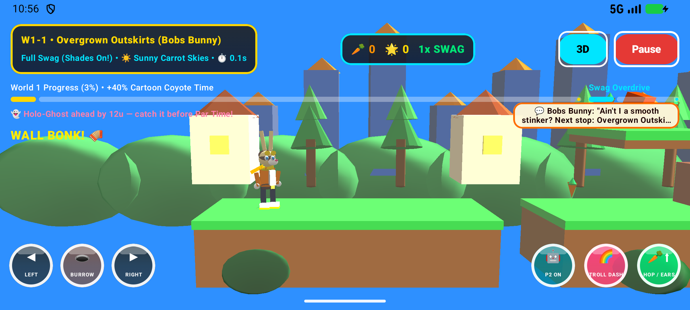

# Bob's Bunny — Wave 4 3D Diorama integration qualification

**Branch:** `feat/bobs-bunny-3d-diorama`  
**PR:** [#2](https://github.com/Bboy9090/Bobs-Bunny-Carrot-City/pull/2) (Draft; targets `feat/bobs-bunny-integration`)  
**Code commits:** `3440512`, `b10a851`  
**Status:** Functional vertical-slice qualification, NOT art or store-release approval.

## Changes in this wave

- **Renderer safety:** shader compile/link checks with descriptive failures, first-drawn-frame signal, loading overlay, OpenGL ES 3.0 capability check and automatic 2D fallback on renderer initialization failure.
- **UI:** landscape-focused phone activity, more compact two-line speech bubble to the right of the character, narrow button text fitted without overflow, touch-control accessibility actions.
- **Navigation regression:** scrollable world-filter selector has stable semantics; instrumented test drives W1-1 3D → 2D → 3D without replacing its game engine or stage state.

## Captured evidence

The second image confirms that the 3D scene rendered after initialization and Bob is no longer obscured by the previous full-width dialogue banner. The screenshots show a **procedural low-poly proof of concept**, not final approved production artwork.

## Test and build record

| Gate | Result |
| --- | --- |
| Android Gradle `testDebugUnitTest` | **11/11 passing** (JUnit XML) |
| Android Gradle `connectedDebugAndroidTest` | **7/7 passing**, no failures, errors or skips (JUnit XML) |
| Android Gradle `assembleDebug` | **PASS** |
| Tested emulator | Android API 37, x86_64, ANGLE/SwiftShader OpenGL ES 3 |
| Debug APK size | ~16 MB |
| Debug APK SHA-256 | `35180a41956345f5a2fd30d94286f4c5ae3f402c826cff9eb728bc321434a963` |
| GitHub Actions Android CI | [Wave 4 run #44013123190](https://github.com/Bboy9090/Bobs-Bunny-Carrot-City/actions/runs/44013123190): **success** |

One initial emulator run failed 2/6 UI tests because it booted in portrait and the narrow world filter could not expose the expected world navigation. The updated landscape configuration and scrolling test selector were subsequently verified: the final **7/7 instrumentation pass** supersedes that earlier failure. This prevents misreporting the initial result as green.

## Remaining release blockers

1. **Art sign-off:** procedural Bob and the Carrot City diorama are technical placeholders awaiting project-owner visual review. Final rigged model, mesh fidelity, textured materials and environment art remain to be produced.
2. **Real-device QA:** no Adreno/Mali GPU, physical touch latency, thermal and sustained FPS measurements. API 26 runtime qualification remains missing.
3. **Full gameplay:** W1-1 has a tested 3D/2D toggle but still requires a player-controlled start-to-finish playthrough, including checkpoints, carrots, foes and stage-completion rewards.
4. **Concurrency:** `CarrotCity3DRenderer` reads mutable `CartoonStageEngine` fields directly from the GL thread. A bounded immutable render-snapshot layer is the next important engineering task.
5. **Android identity:** development app ID `com.example.myapplication` and matching `google-services.json` must be migrated together before a Play release. Do not rename only one side.
6. **Cross-device layout:** fixed landscape orientation is appropriate for the current phone platformer; confirm resize and orientation behavior on foldables and tablets as their Android policies may differ.

**Decision:** Continue the Wave 4 art-quality vertical slice. Retain PR #2 as Draft. Do not merge or publish until visual and physical-device gates pass.

## November 22, 2026 — release-blocker reconciliation

The head of `feat/bobs-bunny-3d-diorama` now includes several follow-up qualifications beyond the original Wave 4 record:

- The former direct GL-thread access to mutable engine entities is resolved by `DioramaFrameBridge` and `DioramaFrameSnapshot`; render state is detached and published as one frame. The current follow-up also makes the captured collections reject mutation through a `MutableList` cast.
- Fixed-step gameplay is covered across 30, 60 and 120 Hz inputs, with bounded catch-up after long frames.
- Background/pause handling releases held controls, pauses a live stage, and changes the renderer to on-demand mode once a paused frame is ready.
- Hosted API 35 software-GLES evidence exists for first-frame rendering and visible W1-1 scene output on earlier exact heads. On `cc004dd6c8a82b3b0867673c82d35ae0cacb72bf`, the first-frame receipt passed (`0 → 1`) and the screenshot captured the game, but the central-scene color gate failed (`sceneColorClasses=3`) because an Android **Quickstep “isn't responding” system dialog** covered the rendered scene. The app log also recorded a 2.6-second/154-frame startup stall before stage navigation. This is not a passed visual gate or physical-device result.

### Current verification attempt

- Debug app-identity preflight: **PASS** (`python3 scripts/check_release_identity.py --profile debug`).
- Local Gradle unit/build execution: **BLOCKED by runner network access**; the wrapper could not download Gradle 9.6.0 from `services.gradle.org`. The exact-head GitHub Android CI workflow nevertheless **PASSed** on `cc004dd6c8a82b3b0867673c82d35ae0cacb72bf` (run #44995554727).
- Local emulator execution: **UNAVAILABLE**; `adb` is not installed in this executor.
- The focused hosted emulator run on that exact head failed the screenshot color gate (run #44995554722). The attempted immediate capture on `90190fbb6da932841d37d8bdaa91ae407a799e13` also failed (`sceneColorClasses=1`, run #44996342895), while the later shell screencap artifact showed the rendered city. This proves the test was capturing a stale Compose/loading frame and then retaining a different screenshot after instrumentation. The follow-up now waits for a tagged loading overlay to disappear and saves the exact bitmap used for assertions to the artifact path; it keeps the existing scene-color threshold.

### Open release blockers

1. Owner visual approval and production-quality Bob/Carrot City art (issue #3).
2. API 26 and physical Adreno/Mali device QA, including sustained frame time, thermal, context loss/resume and input latency (issue #4).
3. Human full-stage playthrough from W1-1 start to reward, including checkpoints, collectibles, foes, save/reload and 2D/3D parity (issue #4).
4. Permanent Android application ID, Play registration and protected release signing/AAB (issue #5).
5. Foldable/tablet resize qualification and platform-specific ports.

**Decision:** Keep PR #2 Draft. The immutable-snapshot unit test and debug APK build passed on `cc004dd6c8a82b3b0867673c82d35ae0cacb72bf`. Visual QA failed on two heads: `cc004dd6` because Quickstep's ANR dialog covered the screenshot, then `90190fbb` because the Compose loading frame was sampled while a later shell screenshot showed the rendered scene. The updated test waits for loading-overlay removal and retains the exact bitmap it checks; exact-head rerun is pending. Art, physical hardware and store gates remain independently open.

### Exact-head retry result on `6875dd2f9596a650fd9e210e5c436ab4189b49b8`

- Android Emulator 3D Visual QA run #44997165437 failed during harness startup, before the instrumentation test: `./scripts/ci-run-emulator-qa.sh: Permission denied` (exit 126). The Git tree had lost the script's executable bit while publishing the preceding change.
- No JUnit report or screenshot artifact was produced; this run provides no gameplay, render, or scene-color result. The repair restores mode `100755` without changing script content. The strict scene-color threshold remains unchanged; rerun on the new exact head is required.
- Android CI run #44997165462 is still in progress as of this ledger update.

**Decision:** keep PR #2 Draft. The latest emulator attempt is a harness-mode failure, not a pass or an app regression result. Previous visual failures remain recorded above. Owner art, API 26/physical hardware, human gameplay and store-signing gates remain open.

### Presented-frame investigation on `e53fc9e2ff5a51b6120b624853400fb0232894f0`

- Android CI run #44997435398 **PASSed** (Unit Tests & Debug APK).
- API 35 emulator Visual QA run #44997435396 **FAILED** after executing instrumentation. Exact diagnostics: `reportedGles=0x30000`, first-frame receipt `0 → 1`, `3dCompleted=true`, `loadingOverlayVisible=false`, `screenshotSaved=true`, `sampledColorClasses=16`, `sceneColorClasses=1`. The retained 1600×900 screenshot has the gameplay HUD over a nearly uniform dark viewport. This is a genuine visible-scene failure, not the earlier system dialog or stale screenshot issue.
- Logcat confirms stage and snapshot initialization, `onSurfaceCreated`/`onSurfaceChanged(1600x900)`, and `onDrawFrame` entry followed by a receipt 2 ms later. No GL initialization error is logged. The receipt was emitted at the end of `onDrawFrame`, before `GLSurfaceView` swapped the rendered buffer. A nonuniform frame was not yet demonstrated at the screen or surface level.
- Follow-up under test: only report first-frame readiness when the next renderer callback proves the prior draw has passed through buffer swap, and directly sample the `GLSurfaceView` with PixelCopy while advancing on Choreographer frame boundaries. Both the direct-surface and composed-screen scene-color checks retain the existing minimum of 6 classes; retries are bounded to 5 seconds and add no fixed sleep.

**Decision:** keep PR #2 Draft. The new frame/surface synchronization is unverified pending exact-head Android CI and API 35 emulator reruns. Do not count #44997435396 as visual QA success.

### Surface-pixel proof and API 35 system-overlay result on `7d174d5a6b368f27bc62a77fa089bf2a85d61c14`

- Android CI run #44998161734 **PASSed** (JVM unit tests and debug APK).
- Emulator Visual QA run #44998161780 **FAILED**. PixelCopy found the `GLSurfaceView`, returned status 0 on its first request, and measured 30 central scene color classes, confirming the native 3D surface buffer contains the rendered world. The full composed screenshot measured 3 central scene classes because Android's **Quickstep isn't responding** modal covered the game. The modal is retained in the artifact and remains a failed visual qualification; no test dismisses or crops it.
- Full instrumentation log shows SurfaceSyncGroup transaction-ready timeouts at 07:29:03.545–.546, app `Skipped 96 frames`, HWUI Davey frames of 1.608 s and 1.435 s, and SwiftShader frame stats up to 1453 ms on HWUI and 102 ms on the GL thread. No `ANR in` or `Input dispatching timed out` diagnostic was captured in the test log. The direct surface and screenshot disagree only because the system modal obscures the latter.
- Hosted-only profile update: reduce the API 35 SwiftShader emulator viewport from 1600×900 to 1280×720 (still landscape 16:9) to reduce raster work after the measured SurfaceSyncGroup/HWUI stalls. The player app and visual thresholds are unchanged. The next exact-head rerun must show the modal-free **full-screen** scene; PixelCopy alone cannot pass the UI screenshot gate.

**Decision:** keep Draft and preserve #44998161780 as a failed API 35 visual attempt. Physical GPU, sustained frame pacing, API 26 and store gates remain unverified.

### Exact-head hosted verification on `278347d7387879e89b069f84afc88193b0291b90`

- Android CI run [#44998757146](https://github.com/Bboy9090/Bobs-Bunny-Carrot-City/actions/runs/44998757146) **PASSed** (job: `Unit Tests & Debug APK`).
- Android Emulator 3D Visual QA run [#44998757114](https://github.com/Bboy9090/Bobs-Bunny-Carrot-City/actions/runs/44998757114) **PASSed** on API 35, x86_64, software GLES / SwiftShader, hosted landscape viewport 1280×720. Job: `API 35 W1-1 3D Emulator QA`.
- Uploaded JUnit reports 8/8 instrumentation tests, zero failures/errors/skips. Both focused and full-suite captures show the 3D city in the composed screenshot: scene-specific color classes 33 and 29; direct GLSurfaceView PixelCopy measured 34 and 29. First-frame/readiness checks passed and the retained full-screen captures are modal-free. The exact artifact is `bobs-bunny-w1-1-android-emulator-qa` (14744533310); JUnit artifact is `bobs-bunny-api35-instrumentation` (14744787521).
- The prior 1600×900 API35 attempt #44998161780 remains a **failed viewport-specific qualification**: its PixelCopy found the 3D scene, but a Quickstep ANR modal obscured the full-screen screenshot. At 1280×720 the full composed screenshot gate passes without dismissing/cropping system UI. This supports only the reduced-resolution hosted SwiftShader profile and does not establish physical-device performance.

### Current blocker ledger

1. **Owner art approval / production artwork** — open, issue #3. Bob and Carrot City assets remain provisional procedural 3D art.
2. **API 26 and physical Android qualification** — open, issue #4. No Adreno/Mali evidence, sustained frame-time/thermal results, touch latency or EGL context-loss/resume proof.
3. **Human end-to-end gameplay** — open, issue #4. A player still needs to complete W1-1 and verify checkpoints, collectibles, foes, save/reload, rewards and 2D/3D parity.
4. **Production Android identity and signed AAB** — open, issue #5. Package/Play registration and owner-controlled protected signing are unresolved.
5. **Foldable/tablet resize and platform ports** — open/unverified.

**Decision:** PR #2 remains Draft. The exact head has passing Android CI and hosted API35 SwiftShader visual/instrumentation evidence at 1280×720 only. The 1600×900 emulator ANR failure remains recorded. No merge, publication or store-readiness claim; physical hardware, API26, owner art, complete human gameplay and signing remain release blockers.
